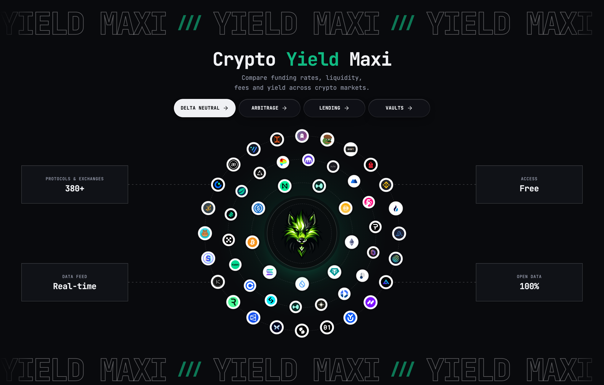
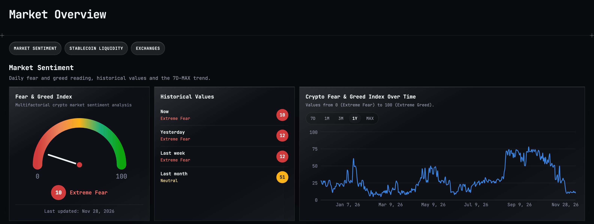
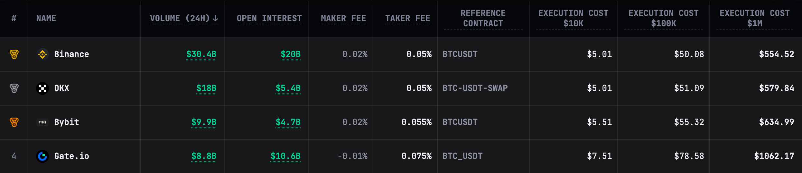
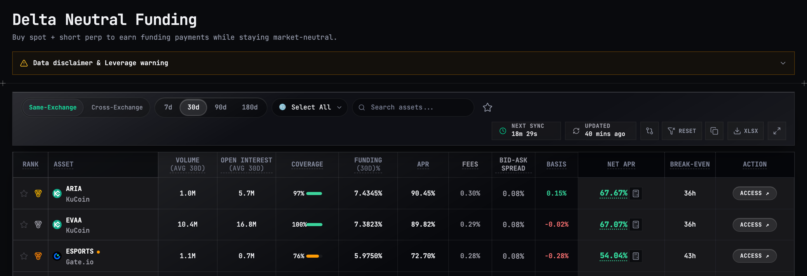
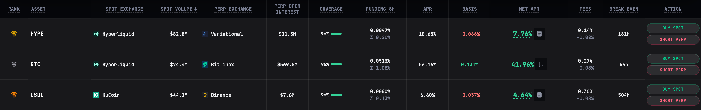
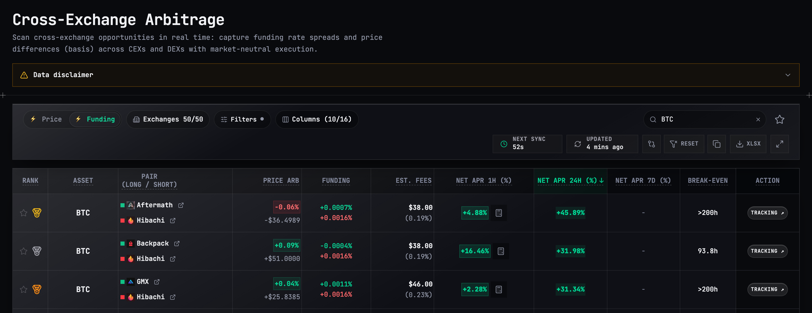
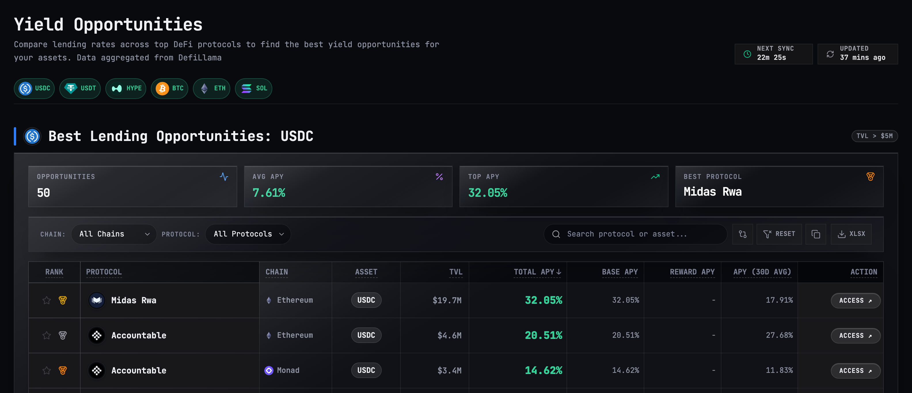
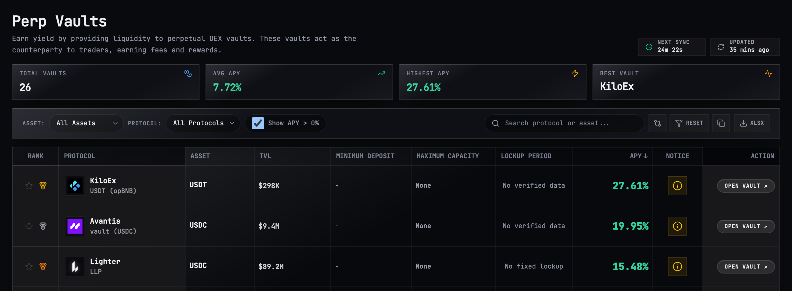
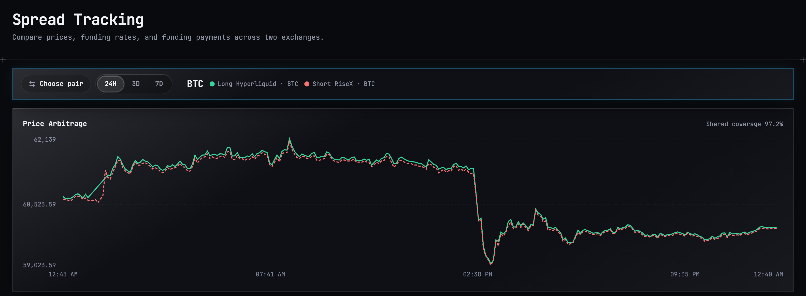

# Yield Maxi

Compare funding opportunities, lending markets, and yield vaults with the context needed to understand their returns.

[Open the dashboard](https://yieldmaxi.xyz/) · [Screenshots and column definitions](dashboard-guide.md)

## Contents

1. [About Yield Maxi](#1-about-yield-maxi)
2. [Market Overview](#2-market-overview)
3. [Delta Neutral](#3-delta-neutral)
4. [Arbitrage](#4-arbitrage)
5. [Lending](#5-lending)
6. [Vaults](#6-vaults)
7. [Using Yield Maxi](#7-using-yield-maxi)

## 1. About Yield Maxi

Crypto yield is spread across exchanges, lending markets, and vaults. Comparing it usually means opening several tabs, checking different time windows, and working out whether an attractive rate still makes sense after costs.

Yield Maxi brings those comparisons into one dashboard. It puts market context, funding opportunities, lending rates, and vault information side by side, helping you move from an initial idea to a closer look at the numbers behind it.

*Home introduces the dashboard and provides entry points to its main analysis tools.*

The goal is to make opportunities easier to assess. A high APR can draw your attention to a market, but it takes more information to decide whether that market deserves a closer look. Liquidity, trading costs, historical coverage, and the terms of the product all affect how you interpret the return on screen.

## 2. Market Overview

Before comparing individual opportunities, it helps to understand the wider market. **Market Overview** brings together market sentiment, stablecoin liquidity, and exchange activity.

The Fear & Greed view places the current reading beside recent values and a historical chart. Stablecoin charts add another perspective by showing changes in market capitalization and USDT dominance over time.

These views are useful together. You can compare the current sentiment reading with earlier periods, then explore the stablecoin charts to see how their market capitalization changed over a similar window. The dashboard keeps those observations close to the exchange comparison so you can move from the broader market to a particular venue.

The **Exchanges** table lets you compare trading volume, open interest, maker and taker fees, and estimated execution costs at different order sizes. Check the reference contract alongside those cost estimates so you know which market the figures describe.

[Explore Market Overview](https://yieldmaxi.xyz/market) · [Read the Stats columns](dashboard-guide.md#stats)

## 3. Delta Neutral

**Delta Neutral** focuses on routes that pair a spot holding with a short perpetual position. It helps you compare the funding opportunity alongside the costs and liquidity of both legs.

Use **Same-Exchange** to examine routes within one venue. The table places funding, gross APR, fees, spread, basis, and estimated Net APR together. **Coverage** shows how much of the selected period is supported by observations, while **Break-Even** gives context for the time needed to recover modeled trading costs.

Switch to **Cross-Exchange** to compare buying spot on one venue and shorting a perpetual on another. The separate venue and liquidity columns help you assess each leg. You can also open the APR history or calculator for a closer look at a route.

Changing the historical window gives you another way to examine the same route. A strong result over a short period may look quite different over a longer one. Read Coverage alongside those figures, since a period with fewer observations gives you less history to work with. When comparing routes across venues, also consider where each position would be held and what moving collateral between them would involve.

[Explore Delta Neutral](https://yieldmaxi.xyz/delta-neutral) · [Read the Delta Neutral columns](dashboard-guide.md#delta-neutral)

## 4. Arbitrage

Two perpetual markets for the same asset can have different prices and funding rates. **Arbitrage** makes those differences easier to compare by showing a long leg and a short leg for each pair.

Use **Price** or **Funding** mode to choose your starting point. Then read the spread alongside estimated fees, historical funding figures, and Net APR. The calculator beside Net APR lets you explore a position size and holding period. Use **Columns** to display additional metrics when you want more detail.

Select **Tracking** to follow the exact pair over time. Spread Tracking separates price history, quoted funding, and settled funding payments into three charts, with **24H**, **3D**, and **7D** windows. This helps you see whether a difference persisted or appeared only briefly.

For example, a pair may stand out in the current funding view while its longer history shows several reversals. Opening Tracking lets you examine when those changes occurred. You can return to the calculator with a holding period in mind and see how the displayed costs affect the estimate, rather than judging the pair from its current rate alone.

[Explore Arbitrage](https://yieldmaxi.xyz/arbitrage) · [Read the Arbitrage columns](dashboard-guide.md#arbitrage) · [Read Spread Tracking](dashboard-guide.md#spread-tracking)

## 5. Lending

**Lending** compares markets by asset, protocol, and chain. It puts pool size and yield information in one table so you can compare options for the same token without repeatedly switching between protocol pages.

Read **Total APY** alongside **Base APY**, **Reward APY**, and the **30D average**. A market supported by temporary rewards can look different from one whose yield comes mainly from lending interest. TVL adds context about the size of the pool, and **Access** opens the provider for further review.

Start by choosing the asset you want to compare, then narrow the table by chain or protocol. This keeps the comparison relevant to where you already hold funds. The current APY and its recent average serve different purposes, so it helps to check both before opening the pool. The provider page remains the place to review its current deposit conditions and reward terms.

[Explore Lending](https://yieldmaxi.xyz/lending) · [Read the Lending columns](dashboard-guide.md#lending)

## 6. Vaults

A vault's return is only one part of the decision. The deposit asset, minimum deposit, capacity, and withdrawal terms also affect whether the product suits your needs.

**Vaults** brings those details together with TVL and reported APY. Open **Notice** for a summary of the strategy, rewards, withdrawal conditions, and risks where information is available. **Open Vault** takes you to the provider to review the current product terms.

This view is especially useful when similar deposit assets lead to different products. Two vaults may accept the same token but have different sources of return or withdrawal schedules. Reading their notices and limits gives you a more complete comparison than sorting by APY alone. Where a field is unavailable, the table leaves that distinction visible so you know which details still need checking with the provider.

[Explore Vaults](https://yieldmaxi.xyz/vaults) · [Read the Vaults columns](dashboard-guide.md#vaults)

## 7. Using Yield Maxi

A useful workflow starts with market context, narrows the comparison to a strategy, and ends with a closer look at the opportunity. Market Overview provides the backdrop. Delta Neutral and Arbitrage help compare trading routes. Lending and Vaults bring yield products into the same research process.

For a trading pair, the historical view provides another check. Compare how the two markets moved, look at their funding history, and read coverage alongside the chart. A continuous line can connect observations across a missing interval, so its appearance alone does not establish complete history.

Yield Maxi makes the figures easier to compare while keeping their context visible. Rates, costs, and available history vary by market and period. Treat the displayed returns as estimates, and use the linked provider pages to review the current terms before acting.

[Start exploring Yield Maxi](https://yieldmaxi.xyz/) · [Open the complete dashboard guide](dashboard-guide.md)

*Screenshots show the live dashboard in dark mode at the time of capture. Open an image to inspect the PNG at full resolution. Displayed figures will change as markets update.*
