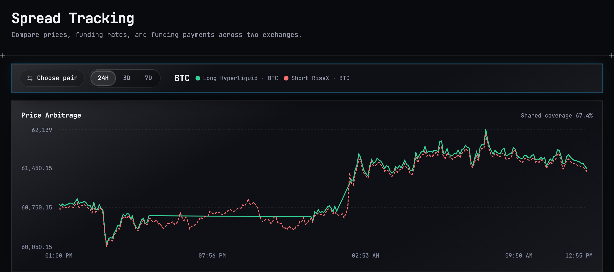

# Yield Maxi

**Compare crypto yields across exchanges and see what sits behind the headline APR.**

Two exchanges can quote different funding rates for the same perpetual contract. That difference might disappear after fees, reverse over a week, or come from a market with very little liquidity. Yield Maxi brings prices, funding, trading costs, and market history together so you can check those trade-offs on one dashboard.

[Open Yield Maxi](https://yieldmaxi.xyz/) · [See screenshots and column definitions](dashboard-guide.md)

## Start with one market

1. Open Arbitrage, search for `BTC` or `ETH`, and pick a row. Each row identifies the long and short venues for that asset. [Open Arbitrage](https://yieldmaxi.xyz/arbitrage)
2. Compare **Est. Fees**, **Volume**, and **Open Interest** alongside **Net APR**. Open the calculator beside Net APR to see how the estimate changes with your position size and holding period.
3. Select **Tracking** on the row. Switch between **24H**, **3D**, and **7D** to see whether the two markets moved together, whether their quoted funding diverged, and which payments settled where history is available. [Open Spread Tracking](https://yieldmaxi.xyz/tools/spread-tracking)

*Compare BTC prices on Hyperliquid and RiseX over the same 24H window. Shared coverage indicates how much of that window has observations from both venues. Open the image to inspect the chart at full resolution.*

## Find the right view

| If you want to know… | Start here |
| --- | --- |
| How do price and funding differ for the same asset across exchanges? | **Arbitrage** compares perpetual pairs, estimated fees, liquidity, and break-even time. [Arbitrage columns](dashboard-guide.md#arbitrage) |
| Has that difference persisted? | **Spread Tracking** compares both legs on a shared timeline, with separate charts for price, quoted funding, and settled payments. [Read the charts](dashboard-guide.md#spread-tracking) |
| How does a spot position paired with a short perp compare across venues? | **Delta Neutral** shows same-exchange and cross-exchange routes, their estimated Net APR, and historical coverage. [Delta Neutral columns](dashboard-guide.md#delta-neutral) |
| How do exchanges compare by activity and trading costs? | **Stats** shows volume, open interest, and fee comparisons alongside market sentiment and stablecoin trends. [Stats and Exchanges](dashboard-guide.md#stats) |
| Where can I compare lending markets or strategy vaults? | **Lending** and **Vaults** show rates and available liquidity information by market or product. [Lending columns](dashboard-guide.md#lending) · [Vault columns](dashboard-guide.md#vaults) |
| What does an incentive campaign require? | **Airdrop** summarizes participation, timelines, and estimated potential for listed campaigns. [Airdrop cards](dashboard-guide.md#airdrop) |
| Can I follow several price charts together? | **Chart** displays multiple symbols in one workspace. [Chart controls](dashboard-guide.md#chart) |

## What goes in and what you get

Yield Maxi uses market-level prices, funding rates and payments, trading volume, open interest, and fees, along with published information about lending markets, vaults, and incentive programs. The dashboard presents comparison tables, yield and cost estimates, and historical charts.

Coverage varies by asset, venue, and period. A high Net APR describes an estimate under the displayed assumptions. Check the period and coverage alongside it, especially when comparing short and long windows. [How to interpret the numbers](dashboard-guide.md#read-the-numbers)
