# Using the Yield Maxi dashboard

This guide explains how to use each view and read its figures. If you are new to Yield Maxi, start with the [project introduction](README.md) for an overview of the features, then return here when you want to understand a column, compare two routes, or inspect a historical chart.

The screenshots show the dashboard in dark mode at the time of capture. Market values change, and available history can differ between assets and venues. Open an image to inspect the PNG at full resolution.

## Contents

1. [Market Overview and exchange statistics](#stats)
2. [Delta Neutral](#delta-neutral)
3. [Arbitrage](#arbitrage)
4. [Spread Tracking](#spread-tracking)
5. [Lending](#lending)
6. [Vaults](#vaults)
7. [Airdrop](#airdrop)
8. [Chart workspace](#chart)
9. [Reading the numbers](#read-the-numbers)

## Finding your way around

Choose a feature from the navigation, then narrow the view to the asset or venue you want to examine. Where available, search, filters, period controls, and column selection let you adjust the comparison without leaving the page. Select a sortable column heading to change the order of the results. A row's rank belongs to the current sort, so it can change when you select another metric.

The star adds a row to your watchlist. Views with a watchlist filter can then show the rows you have saved. Use **Reset** when you want to clear the view's filters. **Updated** indicates the age of the displayed information, while **Next Sync** indicates the expected next refresh. These indicators provide context for the snapshot you are reading.

When a tooltip is available on a heading or value, open it for the metric's definition, assumptions, or additional context. The **XLSX** action exports the current comparison in views that support it.

## Stats
**Market Overview** contains three related views: Market Sentiment, Stablecoin Liquidity, and Exchanges. Use the section links to move between them.

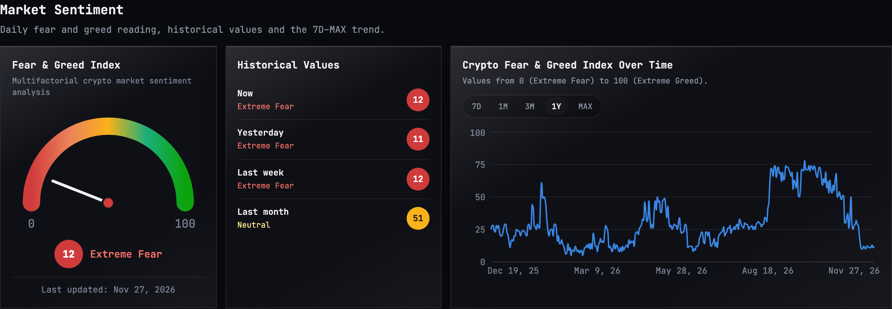

**Market Sentiment** places the latest Fear & Greed score alongside recent readings and a historical chart. The scale runs from 0 (extreme fear) to 100 (extreme greed).

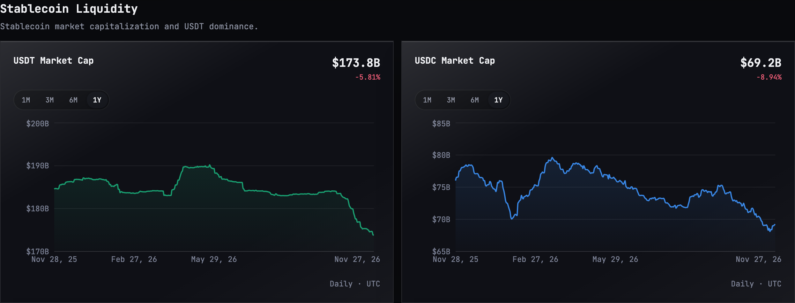

**Stablecoin Liquidity** tracks stablecoin market capitalization and **USDT Dominance**, the share of the overall crypto market capitalization represented by USDT. Use longer windows to put a daily change in context. [Open Stats](https://yieldmaxi.xyz/market) · [USDT Dominance](https://www.tradingview.com/symbols/USDT.D/)

### Exchanges

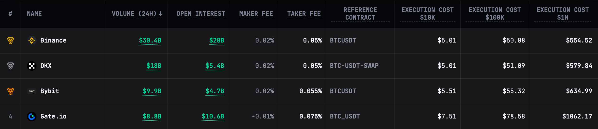

| Column | What it tells you |
| --- | --- |
| **#** | The venue's position in the current sort. |
| **Name** | The exchange being compared. |
| **Volume (24H)** | The USD value traded in tracked perpetual markets over the last 24 hours. Select a value to view its history when available. |
| **Open Interest** | The USD value of open perpetual positions. Select a value to view its history when available. |
| **Maker Fee** | The displayed rate for a fill that adds liquidity. Account terms may change the actual fee. |
| **Taker Fee** | The displayed rate for a fill that removes liquidity. |
| **Reference Contract** | The specific contract used to estimate execution costs for that venue. |
| **Execution Cost $10K** | Estimated one-way cost in USD for a $10,000 order on the reference contract. |
| **Execution Cost $100K** | Estimated one-way cost in USD for a $100,000 order on the same reference contract. |
| **Execution Cost $1M** | The same comparison at $1 million. An estimate may be unavailable where a fill at this size cannot be assessed. |

Check the estimate's tooltip for its cost basis. Compare the same reference contract and order size when you can. An execution estimate for one contract does not describe every market on that exchange.

Select an interactive Volume or Open Interest value to open the venue history popup. **VOL** and **OI** switch the metric, and the period buttons change the historical window. The summary beneath the chart shows the minimum, average, maximum, number of points, and coverage. **Access** opens the selected exchange. A collecting or unavailable state means there is not enough history to draw the requested comparison yet.

## Delta Neutral
Start by choosing **Same-Exchange** or **Cross-Exchange**, then select the period and narrow the table by asset or exchange. Read liquidity and coverage alongside the estimated return before comparing routes. The two modes describe different arrangements for the spot and perpetual legs.

In **Delta Neutral**, choose **Same-Exchange** to see spot and perp legs on one venue, or **Cross-Exchange** to compare routes that use two venues. Pick a historical window and compare **Net APR**, **Coverage**, and liquidity across routes. Cross-exchange routes also require you to consider where collateral is held and how funds can move between the venues. [Open Delta Neutral](https://yieldmaxi.xyz/delta-neutral)

### Same-Exchange

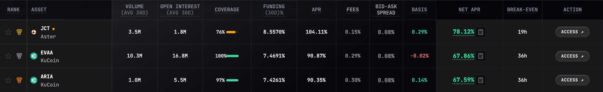

| Column | What it tells you |
| --- | --- |
| **Rank** | The route's position under the current sort. The star adds it to your watchlist. |
| **Asset** | The underlying asset and the exchange used for both the spot and perpetual legs. |
| **Volume (Avg)** | Average spot trading volume for the selected window. |
| **Open Interest (Avg)** | Average open interest for the perpetual market over the selected window. |
| **Coverage** | The share of the selected period backed by observations. |
| **Funding** | Funding for the selected period, expressed as a percentage. Positive funding is paid by longs to shorts. |
| **APR** | Gross annualized funding yield before modeled trading costs. |
| **Fees** | Estimated trading fees for the spot and perpetual legs. |
| **Bid-Ask Spread** | Estimated execution cost from the bid and ask gaps in the two markets. |
| **Basis** | The price difference between the perpetual and spot legs. |
| **Net APR** | Estimated annualized return after costs and basis. The chart and calculator icons give more context for a route. |
| **Break-Even** | Estimated days of funding income required to recover modeled trading costs. |
| **Action** | Opens the exchange for the selected route. |

### Cross-Exchange

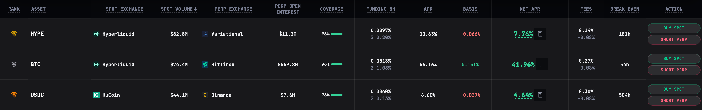

| Column | What it tells you |
| --- | --- |
| **Rank** | The route's position under the current sort. |
| **Asset** | The underlying asset shared by the spot and perpetual legs. |
| **Spot Exchange** | The venue used to buy the asset. |
| **Spot Volume** | Trading volume on the spot leg. |
| **Perp Exchange** | The venue used to short the perpetual. |
| **Perp Open Interest** | Open interest on the perpetual leg. |
| **Coverage** | The share of the selected period with qualifying observations for this route. |
| **Funding 8H** | The perpetual leg's funding expressed on an eight-hour basis. The smaller **Σ** value estimates cumulative funding for the selected window. |
| **APR** | Gross annualized funding yield before modeled trading costs. |
| **Basis** | The price difference between the perpetual on one venue and spot on the other. |
| **Net APR** | Estimated annualized return after costs and basis. Select the value for APR history or use the calculator beside it. |
| **Fees** | Estimated round-trip fees for both legs. The smaller line shows the estimated spread cost separately. |
| **Break-Even** | Estimated days of funding income required to recover the modeled trading costs. |
| **Action** | Opens the spot and perpetual venues through separate links. |

### Inspect a route before comparing returns

Select an interactive **Net APR** value to open its history. The period buttons let you compare the same route over different windows, and the coverage figure helps you judge how much history supports the displayed result. A longer window can have less coverage, especially for markets with a short available history.

The calculator beside Net APR lets you explore capital and holding period assumptions. **Access** opens the venue for a route within one exchange. In Cross-Exchange mode, the separate action links identify where to buy spot and where to short the perpetual. Check both destinations when reviewing the route.

## Arbitrage
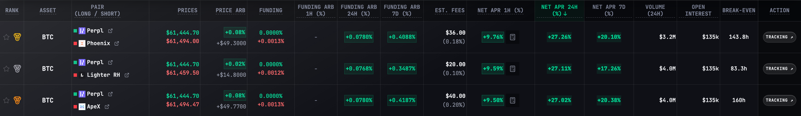

**Price** mode is a starting point for comparing entry prices. **Funding** mode is a starting point for comparing recurring funding. Choose **Columns → All columns** to display the full table.

| Column | What it tells you |
| --- | --- |
| **Rank** | The row's position under the current sort. Use the star to add the pair to your watchlist. |
| **Asset** | The underlying asset shared by the two perpetual contracts. |
| **Pair (Long / Short)** | The exchange for the long leg is shown first, followed by the exchange for the short leg. |
| **Prices** | The displayed ask for entering the long and bid for entering the short. |
| **Price Arb** | The entry price difference, shown as a percentage and as a price difference per unit. A positive value means the short bid is above the long ask. |
| **Funding** | The current funding rate for each leg. Check each contract's funding interval when comparing rates. |
| **Funding Arb 1H** | The current short-leg funding rate minus the long-leg rate, expressed per hour. An **≈** marks a conversion from a different funding interval. |
| **Funding Arb 24H** | The cumulative funding difference for the two legs over the past day, when sufficient history is available for both. |
| **Funding Arb 7D** | The cumulative funding difference over the past seven days, when sufficient history is available for both legs. |
| **Est. Fees** | Estimated trading fees for opening and closing both legs at the table's reference position size. The calculator lets you explore a different size. |
| **Net APR 1H** | Estimated annualized return using current funding conditions, entry prices, and modeled costs. The calculator next to it lets you change the position size and holding period. |
| **Net APR 24H** | Estimated annualized net return using the 24H funding history. |
| **Net APR 7D** | Estimated annualized net return using the 7D funding history. |
| **Volume (24H)** | The lower 24-hour trading volume across the two contracts. |
| **Open Interest** | The lower open interest across the two contracts. |
| **Break-Even** | Estimated hours of funding income required to cover the modeled round-trip fees. |
| **Action** | **Tracking** opens the historical charts for the exact long and short contracts in the row. |

### Current rates and historical figures

**Funding Arb 1H** expresses the current funding difference per hour. The **≈** symbol means a rate has been converted from another funding interval. It does not mean that the two venues settle at the same time, or that a funding payment has already been received.

**Net APR 1H** is an annualized estimate based on current conditions. The name identifies the funding rate basis, not a one-hour holding period. **Net APR 24H** and **Net APR 7D** use their respective historical windows. These figures can disagree when funding changes direction. A dash in a historical column means the available history does not support that figure for the pair.

### Follow a funding opportunity

Open **Arbitrage** and choose **Funding**. Search for an asset and read each row from left to right. The first exchange is the long leg and the second is the short leg. Check the price gap and estimated fees before reading Net APR. Select **Tracking** to open the same two contracts in Spread Tracking. [Open Arbitrage](https://yieldmaxi.xyz/arbitrage)

Suppose a pair shows **+0.08% Funding Arb over 24H** and **−0.12% over 7D**. Those illustrative numbers say that the latest day favored the displayed direction while the full week went the other way. Open the 7D charts to see when funding changed and whether both venues have enough history to compare. Then use the calculator to compare estimated fees and projected return at your intended holding period.

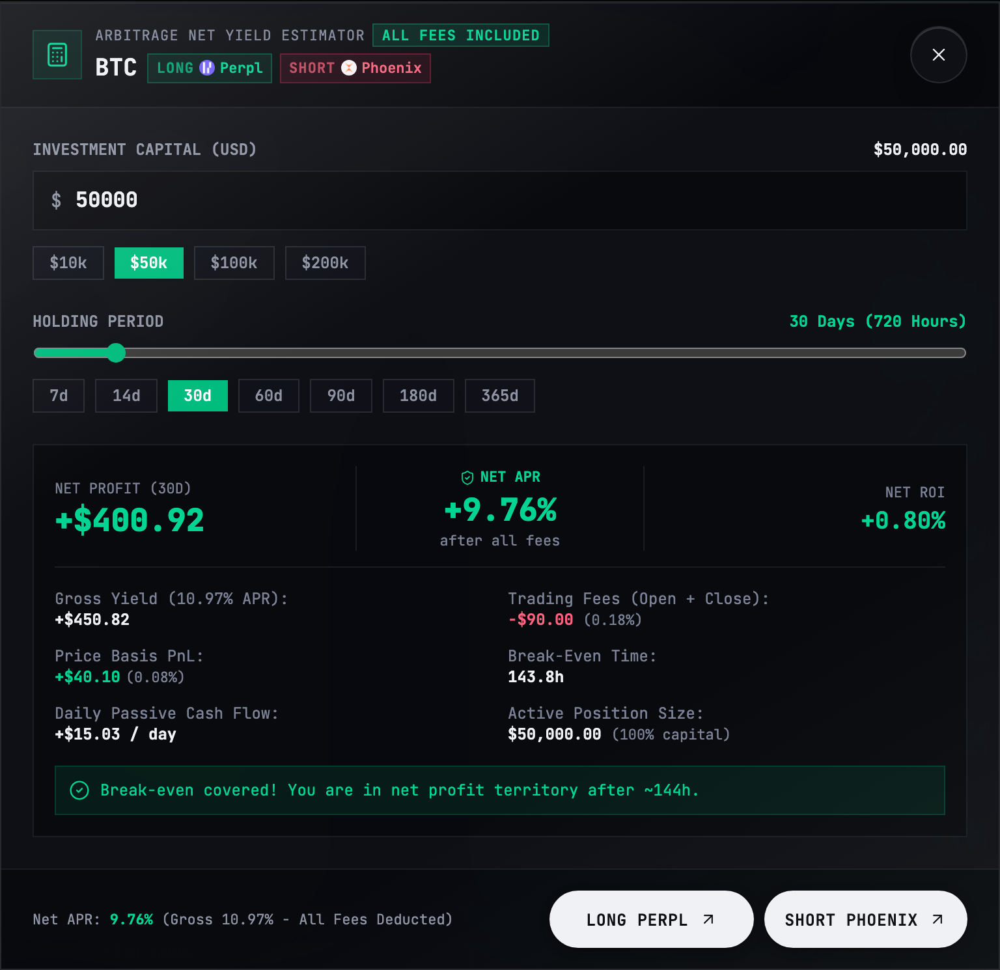

### Use the calculator

Open the calculator beside Net APR. It starts with **$50,000** and **30 days**. You can enter another capital amount, use the quick presets, or adjust the holding period with the slider and day buttons.

**Net Profit** is the estimated dollar result for the selected hold. **Net ROI** expresses that result as a percentage of the entered capital. **Net APR** expresses it on an annualized basis. The breakdown shows the estimated trading fees and price basis separately.

The breakdown also includes daily cash flow, active position size, and estimated break-even time. These help explain the estimate under the selected assumptions. Changing the holding period changes the projection, but it does not establish what future funding will be.

For an Arbitrage pair, the **Long** and **Short** buttons open the venues for the two legs separately. Check the venue names and contracts before following those links.

## Spread Tracking
Open **Tracking** from an Arbitrage row to carry its asset and exact contracts into this page. **Choose pair** lets you return to pair selection. Read the long and short venue labels before comparing the charts, since the same asset can have different contract names on different venues.

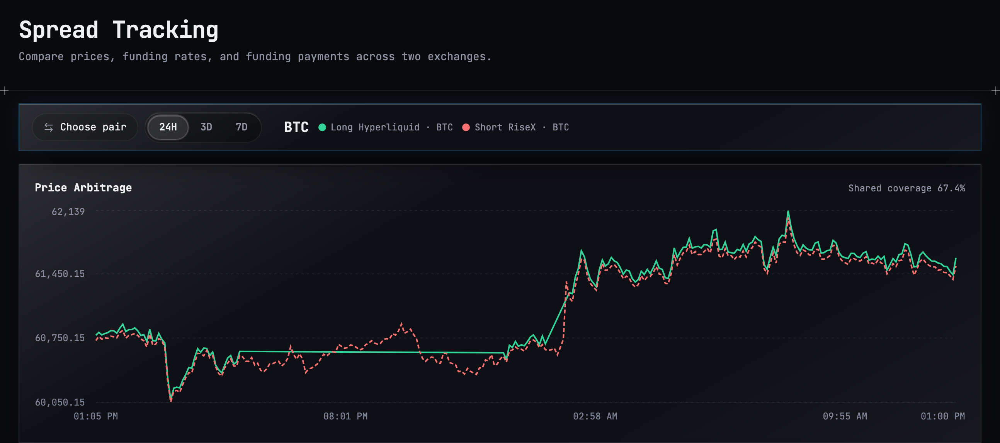

| Chart | What to look for |
| --- | --- |
| **Price Arbitrage** | Compare the two price lines. Look for when the price gap widened or narrowed across the two venues. |
| **Funding Arbitrage** | Compare quoted funding over time. Watch for brief spikes, sustained differences, and reversals. |
| **Funding Payment History** | Read net settled funding for the displayed direction, calculated as short-leg funding minus long-leg funding. Positive bars favor that direction; negative bars work against it. A bucket needs observations from both legs. |

Start with **24H** to inspect recent moves. Use **3D** or **7D** to see whether the pattern repeats. **Shared coverage** measures how much of the selected window has observations from both legs. A line can connect observations across a missing interval, so a continuous line alone does not mean coverage is complete. [Open Spread Tracking](https://yieldmaxi.xyz/tools/spread-tracking)

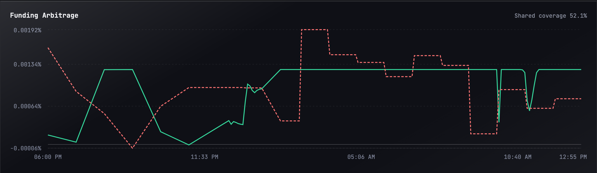

*Funding Arbitrage shows when the venues quoted different rates during the day.*

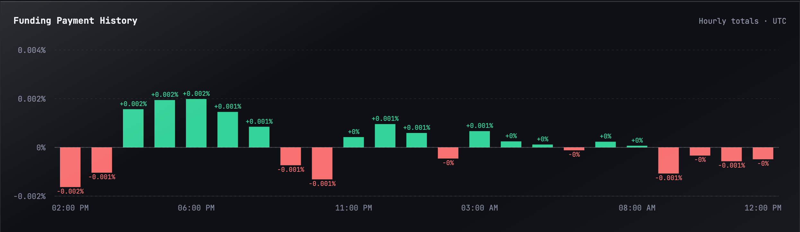

*Funding Payment History shows net settled funding by time bucket. Green bars are positive and red bars are negative.*

The **24H** view shows hourly totals in UTC. The **3D** and **7D** views use daily totals to keep the payment history readable. Hover a bar to inspect both legs and the net value. A missing bar can mean there are not enough observations from both legs for that bucket, so it should not automatically be read as a zero payment.

Quoted funding and settled payments answer different questions. The Funding Arbitrage chart shows how quoted rates varied. Funding Payment History shows the available settlement history for the displayed direction. Read the timestamp and aggregation window when moving between them.

## Lending
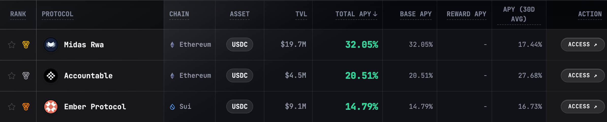

Choose an asset using the token navigation, then narrow the results by chain, protocol, or search. Compare pools for the same asset across chains. A pool can have a higher **Total APY** because of temporary incentives, so read **Base APY**, **Reward APY**, and **APY (30D avg)** together. [Open Lending](https://yieldmaxi.xyz/lending)

| Column | What it tells you |
| --- | --- |
| **Rank** | The pool's position under the current sort. The star adds it to your watchlist. |
| **Protocol** | The lending platform that hosts the pool. |
| **Chain** | The blockchain network on which the pool operates. |
| **Asset** | The token supplied to the pool. |
| **TVL** | Total USD value currently supplied to the pool. |
| **Total APY** | Current annual percentage yield from base interest and rewards, where applicable. |
| **Base APY** | The portion of yield from lending activity. |
| **Reward APY** | The portion of yield from incentives. |
| **APY (30D avg)** | Average reported APY over the past 30 days. |
| **Action** | Opens the pool or protocol page. |

### Compare pools for the same asset

Begin with the asset you intend to supply. Check the chain and protocol, then compare current Total APY with its base and reward components. Read the 30D average to see how the recent reported yield compares with the current figure.

A dash in Reward APY or the historical average means the value is unavailable. It is different from a displayed zero. Use **Access** to review the pool on the provider's page, including its current deposit and reward terms.

## Vaults
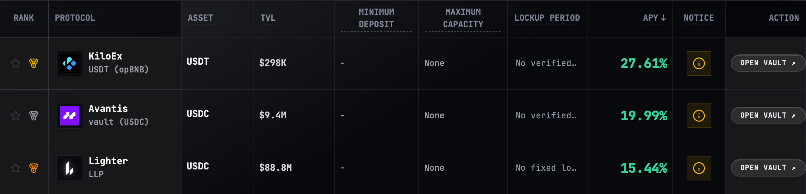

Start with the deposit asset and lockup period, then use **Notice** to see how the vault works and what can affect the return. [Open Vaults](https://yieldmaxi.xyz/vaults)

| Column | What it tells you |
| --- | --- |
| **Rank** | The vault's position under the current sort. The star adds it to your watchlist. |
| **Protocol** | The venue or protocol operating the vault. |
| **Asset** | The token accepted for deposits. |
| **TVL** | Total USD value held in the vault. |
| **Minimum Deposit** | The smallest deposit the vault accepts. |
| **Maximum Capacity** | The published deposit cap or vault capacity, depending on how the product reports its limit. |
| **Lockup Period** | The reported lockup or cooldown that applies before a withdrawal completes. |
| **APY** | Current reported annual percentage yield for the vault. |
| **Notice** | Opens details about the strategy, restrictions, and risks. |
| **Action** | Opens the provider's vault page. |

### Read the Notice before opening a vault

Use the asset and protocol filters to narrow the list. The **APY > 0%** filter can limit the view to products with a positive reported APY. Compare the deposit asset, capacity, and withdrawal terms alongside that rate.

**Notice** opens the protocol details popup. Where information is available, it describes the source of yield, withdrawal process, rewards, and risks. **Got it** closes the popup, while **Open Vaults** takes you to the provider. An unavailable or unverified lockup value is a detail to confirm with the provider before using the product.

## Airdrop
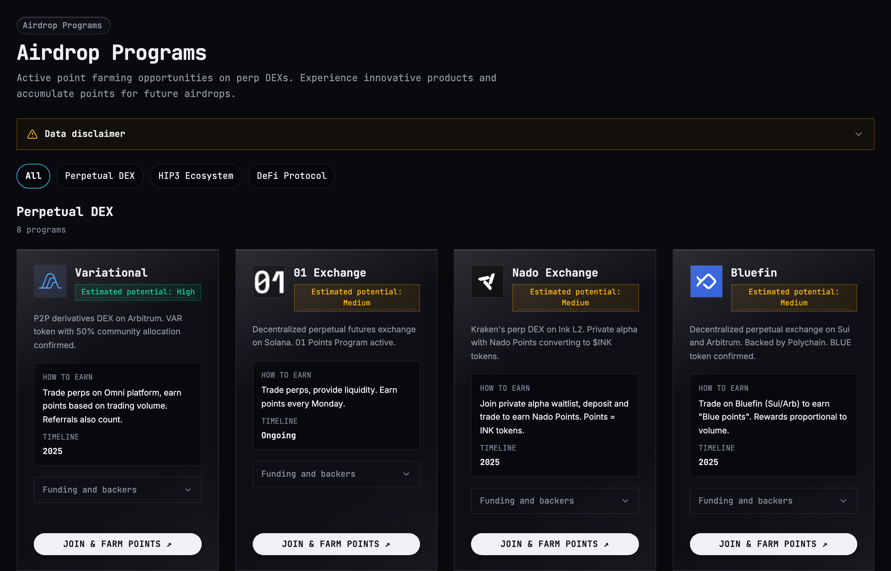

Use the category filters to switch between perpetual DEX, HIP3 Ecosystem, and DeFi Protocol programs. Each card summarizes what participants can do and the details available for the program. [Open Airdrop](https://yieldmaxi.xyz/airdrop)

| Card field | What it tells you |
| --- | --- |
| **Program name and description** | Identifies the project and summarizes the campaign. |
| **Estimated potential** | A qualitative High, Medium, or Low rating. Actual eligibility, allocation, and payouts depend on program terms. |
| **How to Earn** | The activity the program lists for participation, such as trading or providing liquidity. |
| **Timeline** | The published timing when available. |
| **Funding and backers** | Disclosed fundraising and investor information for the project. |
| **Join & Farm Points** | Opens the project or program page so you can check its current terms. |

The potential rating is a qualitative comparison, not a promised payout. Open **Funding and backers** for the information listed about the project, then follow **Join & Farm Points** to review the program itself. Participation instructions and timelines should be read together, since completing an activity does not by itself establish eligibility for a reward.

## Chart
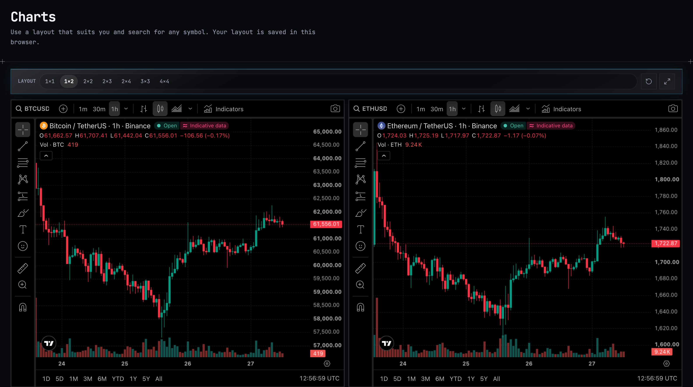

Use the separate **Chart** workspace for price analysis across several panels. Choose a **Layout** for the number of panels you want and set the **Symbol** in each panel. Your layout is saved in the current browser. For funding quotes or settlement history for a specific pair, use Spread Tracking. [Open Chart](https://yieldmaxi.xyz/tools/chart)

Each panel can show a different symbol. Change the layout to give a chart more room or to keep several markets visible at once. This workspace is useful for price chart comparison. Use **Tracking** on an Arbitrage pair when you want its specific price, funding, and payment histories together.

## Read the numbers
| Metric | How to interpret it |
| --- | --- |
| **Net APR** | An annualized estimate based on the displayed window and cost assumptions. A short window can make a brief funding spike look large when annualized. |
| **Coverage** | How much of the selected period has observations. Compare results over the same window and check both legs when coverage is uneven. |
| **Volume and Open Interest** | Volume measures recent trading activity. Open interest measures positions still open. Both help assess market activity, while execution also depends on the size of your order and available liquidity. |
| **Break-even** | The estimated time for funding income to offset the displayed trading costs under the current assumptions. A move in funding or execution prices can change it. |
| **A dash or blank value** | The figure is unavailable for that pair and period. A displayed `0` means the available data supports a zero value at the shown precision. |

A larger value is not always the more useful comparison. Check that the asset, period, and metric have the same meaning across the rows you are comparing. A short period can emphasize a recent funding move, while a longer one can reveal that the direction changed earlier.

Coverage describes available observations, not whether an opportunity will remain profitable. A chart can connect points across a missing interval, and a blank historical figure can remain blank even when current prices and rates are present. Use the period controls and coverage labels together to understand what history is available.

For background on perpetuals, funding, and other yield strategies, see the product guide. [Yield Maxi product guide](https://yieldmaxi.xyz/guide)
