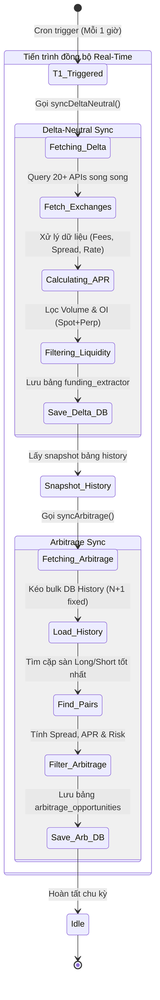
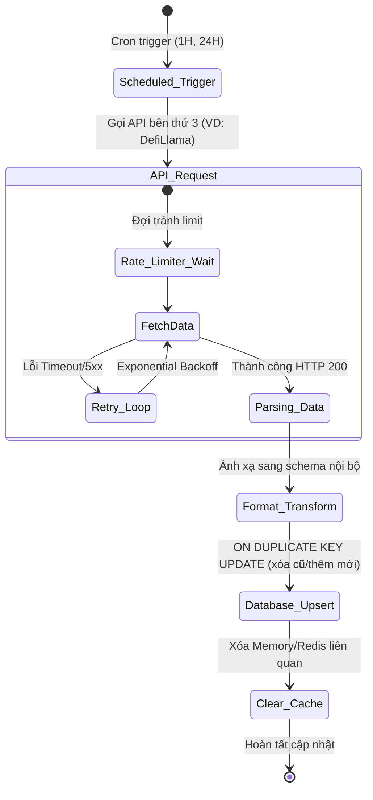
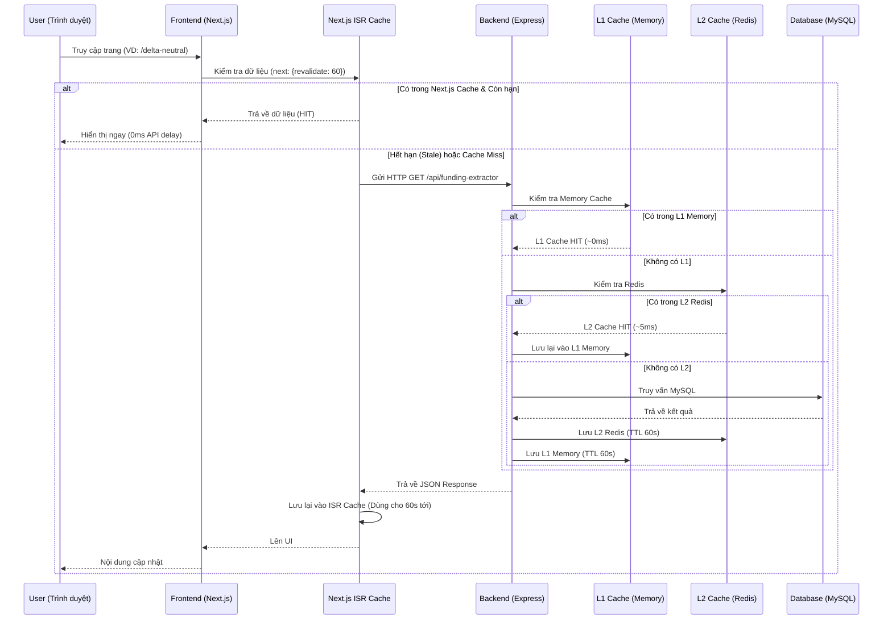
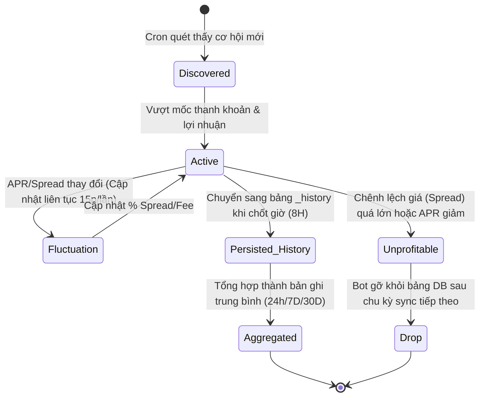

# Application State Machines & Diagrams

Tài liệu này mô tả vòng đời (lifecycle) và các trạng thái (states) của các luồng dữ liệu, tiến trình nền (cron jobs), và kiến trúc caching trong hệ thống **Crypto Yield Maxi**.

---

## 1. Sync Flow (Luồng đồng bộ)

Luồng này chịu trách nhiệm thu thập, tính toán và lưu trữ các cơ hội giao dịch (Delta Neutral, Arbitrage) từ hơn 20 sàn giao dịch. Nó được kích hoạt liên tục thông qua Cron Job.

**Chi tiết luồng:**
1. Khởi động từ `cron/index.ts`.
2. **Delta Neutral** xử lý cập nhật dữ liệu Funding chung.
3. **Snapshot History** chạy ngay trong `syncDeltaNeutral()` để đảm bảo DB luôn lưu lại phiên cập nhật mới nhất.
4. **Arbitrage** tính toán mức chênh lệch giữa các cặp sàn.

---

## 2. External Data Sync Flow (Luồng đồng bộ từ bên thứ 3)

Luồng này phục vụ cho các mảng DeFi tĩnh hoặc ít thay đổi (Lending, Vaults, Listings sàn), chạy với chu kỳ dài hơn (Hàng giờ hoặc Hàng ngày).

**Các chu kỳ:**
* **Delta Neutral Sync:** Kích hoạt tại phút thứ 1 mỗi giờ.
* **Arbitrage Sync:** Kích hoạt tại phút thứ 3 mỗi giờ.
* **Lending Sync:** Kích hoạt tại phút thứ 7 mỗi giờ.
* **Vault Sync:** Kích hoạt tại phút thứ 9 mỗi giờ.
* **Exchange Metadata Sync:** Kích hoạt hàng ngày lúc 1:00 AM UTC.

---

## 3. Request Caching State Machine (Luồng phản hồi API cho UI)

Hệ thống có 3 tầng cache (Frontend ISR, Backend Memory, Backend Redis) để tối ưu độ phản hồi dưới 100ms.

**Chiến lược tối ưu:**
1. **Frontend không trực tiếp gọi API Backend per-request** nhờ cấu hình `next: { revalidate }`. Khách hàng thứ 1000 truy cập chung 1 phút sẽ nhận cùng 1 static HTML/JSON từ node server của Vercel/Next.js.
2. **Backend MemCache (L1) ngăn chập tải Redis:** Nếu Frontend cache bị miss, API request đập vào BE, BE lập tức trả ra từ biến Map() Memory cực nhanh.
3. **Redis (L2) chia sẻ liên server:** Nếu Backend có nhiều node hoặc Worker vừa chạy xong, kết quả tính toán có sẵn ở Redis chia cho mọi processes.

---

## 4. Single Opportunity Lifecycle (Vòng đời của cơ hội Arbitrage/Funding)

Máy trạng thái vòng đời của một kết quả cụ thể trong DB (ví dụ: Chênh lệch giá PURR).

1. **Sinh trưởng:** Một cơ hội xuất hiện mỗi vòng Sync (Khoảng 15p).
2. **Tuổi thọ thực (Active):** Thay đổi liên tục, "nhấp nháy" phần trăm lợi nhuận. Nếu đáp ứng tiêu chuẩn, được phơi lên UI.
3. **Dập tắt (Drop):** Ở lần sweep tiếp theo, MySQL sẽ tiến hành `ON DUPLICATE KEY UPDATE` hoặc xóa/tạo lại nếu tỷ giá biến mất, cơ hội hết vòng đời.
4. **Di sản (History):** Tại mốc chẵn giờ, nó được đưa vào `_history` để sau này phục vụ các tính toán chu kỳ dài.
