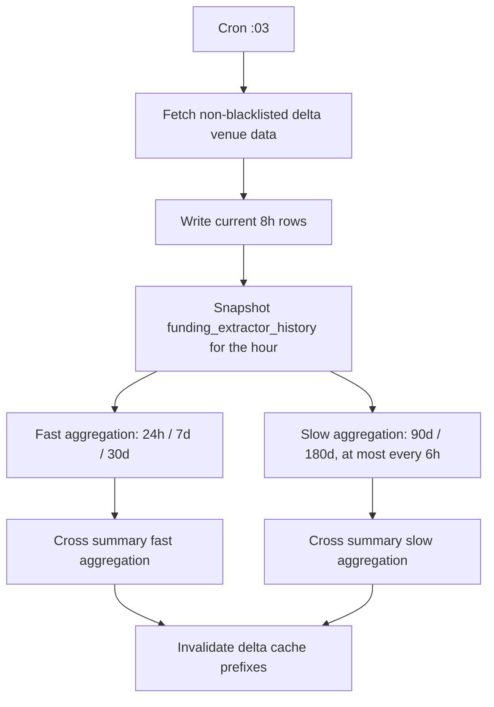
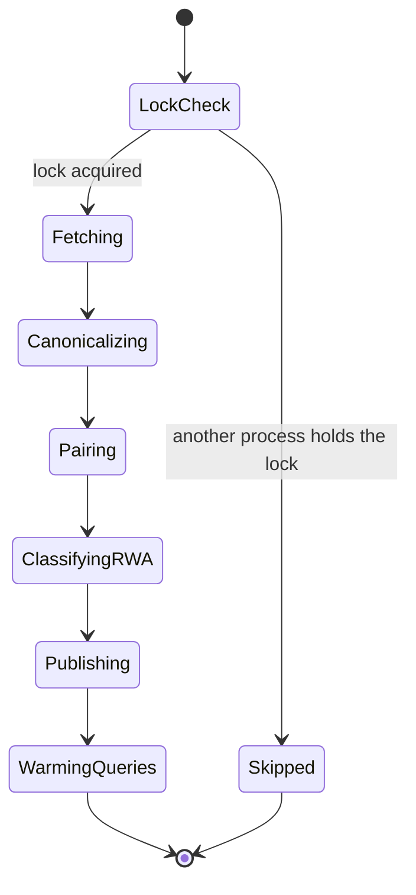
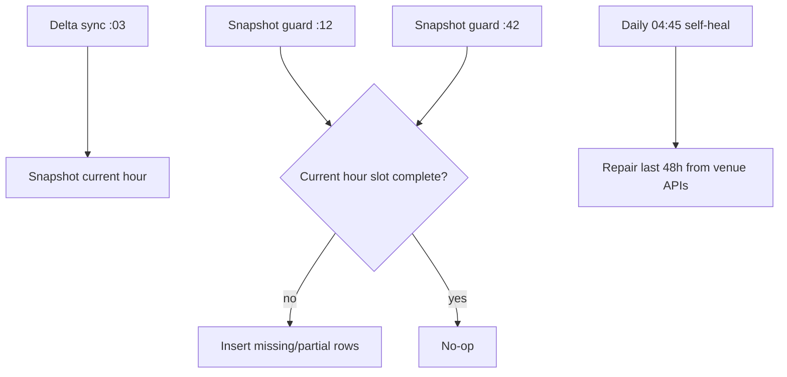
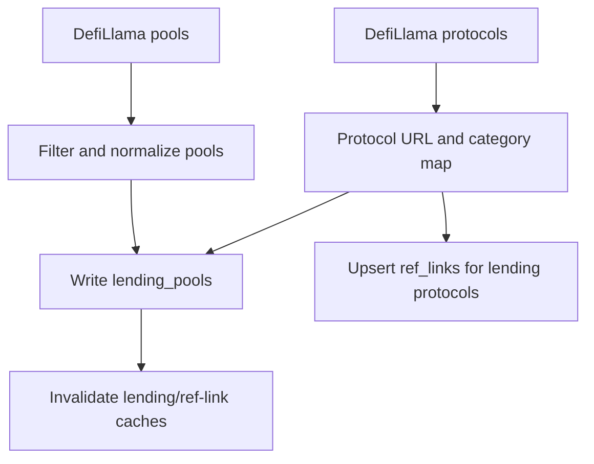
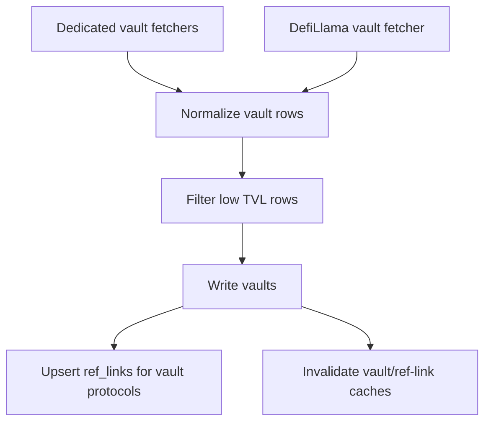
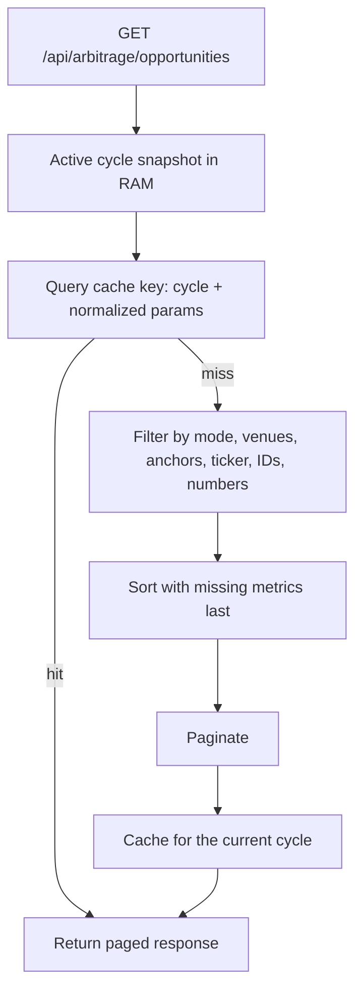
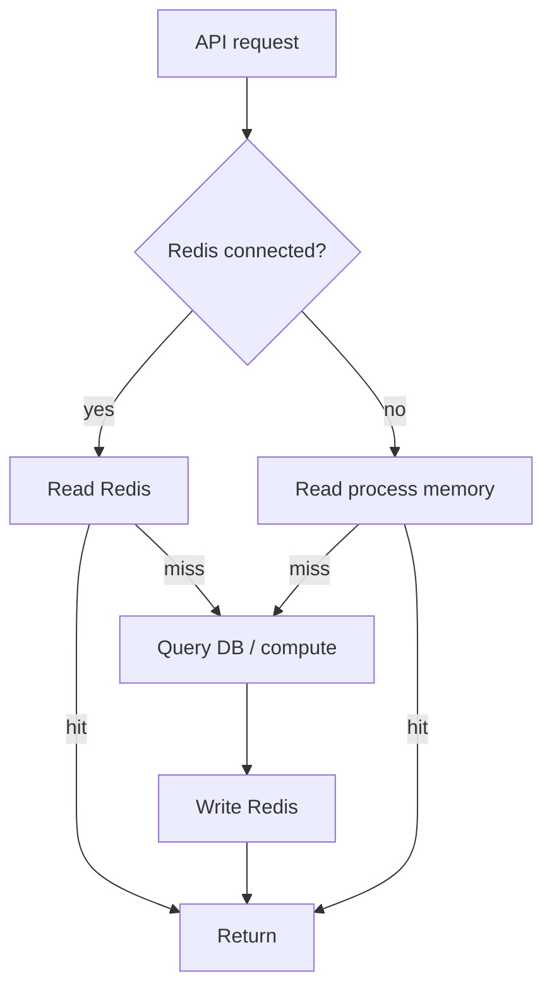
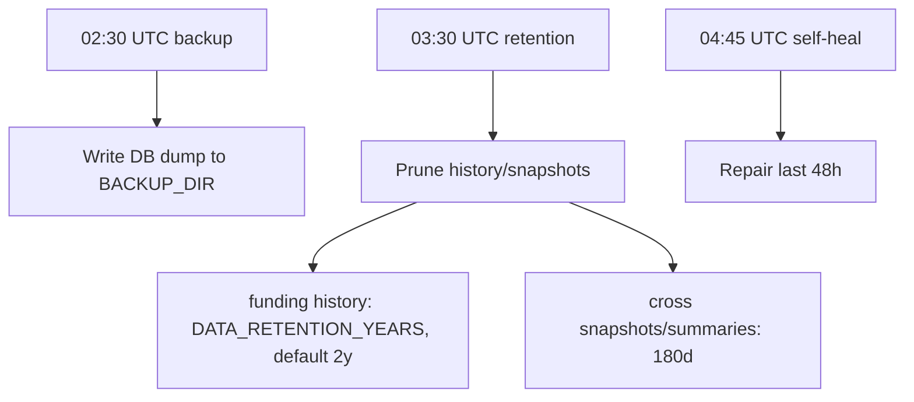

# Application Flows

This document summarizes the current sync, recovery and cache flows.

## 1. Delta-Neutral Sync Flow (hourly at `:03`)



Notes:

- Fast and slow aggregations run independently, so a slow 90d/180d rebuild does not block the hourly 24h/7d/30d refresh.
- Each period is bounded by a stall/freshness window; stale rows are not served by the API.
- Current 8h rows are live venue data; aggregated periods are computed from hourly history with coverage checks.
- Cross same-asset routes are snapshotted during the sync and aggregated into `delta_cross_period_summaries`.

## 2. Arbitrage Scanner Flow (every 5 minutes)



Notes:

- The worker and API processes share a Redis lock; only one full scan runs at a time.
- All non-blacklisted clients are fetched with per-venue timeouts.
- Symbols are canonicalized and contract-size variants (PEPE / 1000PEPE / 10000SATS) are grouped under one base ticker.
- Asset class is resolved from venue metadata + the shared `rwa_assets` registry.
- The scanner records hourly 1h-rate buckets in `funding_rate_snapshots`, then rebuilds 24h/7d sums used by the realized funding metrics.
- The cycle snapshot is written to Redis and adopted by API workers into RAM.
- API workers use stale-while-revalidate: requests get the current RAM snapshot while a newer Redis cycle is parsed in the background.
- Common page-1 query variants are warmed after each sync.
- If the scanner has not produced fresh data for 15 minutes, the staleness monitor sends a Telegram alert; it sends a recovery alert when data resumes.

## 3. Hourly History Safety Nets



- The normal snapshot happens inside the delta sync.
- The `:12` and `:42` guards repair a missing/partial slot if the sync was still running, the worker restarted, or the first pass was partial.
- The daily `04:45 UTC` job repairs hours where a specific symbol was missed by the sync itself.

## 4. Lending Sync Flow (hourly at `:07`)



## 5. Vault Sync Flow (hourly at `:09`)



Vault fetchers currently registered: Hyperliquid, Jupiter, Paradex, Extended, Lighter, GRVT, Reya, Ostium, Bluefin, KiloEx, DefiLlama, RiseX, ApeX, EdgeX.

## 6. Arbitrage Query Flow



Important properties:

- The query key includes the cycle timestamp, so a new snapshot invalidates old query results logically.
- Concurrent cache misses are coalesced to avoid re-sorting the same large snapshot in every request.
- The watchlist-only view sends `ids`; an empty watchlist sends `__NONE__` so it returns zero rows instead of the full set.

## 7. Guide Exchange Flow

```mermaid
flowchart TD
    A[Curated frontend exchange lists] --> C[Render guide cards]
    B[/api/home/exchange-ref-links] --> D[Override curated ref links by slug]
    D --> C
```

This replaced the older exchange-directory cron-driven flow. Curated order and copy live in `frontend/lib/exchanges.ts`.

## 8. Cache and Invalidation Flow



- Redis is authoritative while connected. Process memory is only used when Redis is unavailable or a write failed.
- Sync completions invalidate cache prefix groups (`delta`, `lending`, `vaults`) instead of waiting for TTL expiry.
- Main TTLs: funding extractor/cross and lending/vaults `70 min`; arbitrage query cache `5 min`; scanner snapshot kept for `24 h` to survive restarts; airdrops/exchange list `12 h`.

## 9. Retention and Backup Flow (daily)



- Retention runs under a Redis lock so a manual `pnpm db:cleanup` does not overlap the cron run.
- PM2 restarts the cron worker at `05:30 UTC`, after backup, retention and self-heal have had time to finish.
